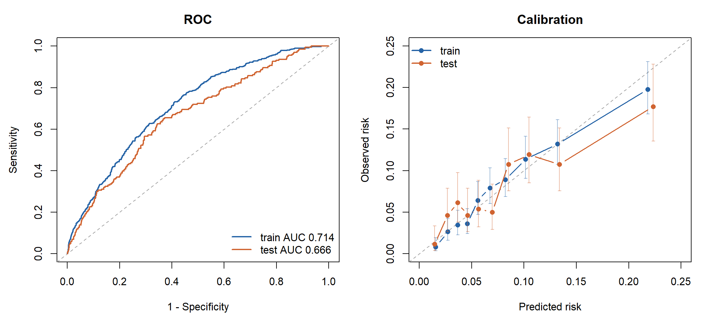
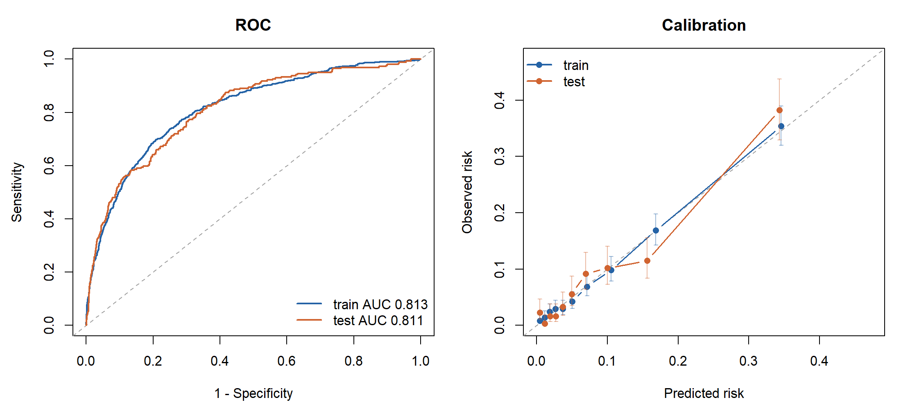

# CT2D-T2DM-5Year-Prediction-Models
Development of Prognostic Prediction Models and a Visual Risk Assessment Platform for Type 2 Diabetes Based on the Changshu Type 2 Diabetes Cohort in China

# 2型糖尿病5年预后预测模型

基于中国常熟市2型糖尿病队列（CT2D）队列构建的预后预测模型与Shiny可视化风险评估平台，用于评估2型糖尿病人群基线后5年内的新发心血管并发症和全因死亡概率，为预后研究与个体化风险沟通提供便捷工具。

[在线风险评估](https://01a1332f-05e8-83cc-ccf9-207cf3304b4e.share.connect.posit.cloud/) · [项目首页](https://jiuqiong.github.io/CT2D-T2DM-5Year-Prediction-Models/) · [手动发布说明](GitHub发布说明.md)

> 首次配置GitHub Pages前，可以直接通过“在线风险评估”链接使用平台。

## 评估内容

| 预测结局 | 适用人群 | 结局范围 |
|---|---|---|
| 新发心血管并发症 | 基线无冠心病或卒中的2型糖尿病人群 | 基线后5年内首次冠心病或卒中事件 |
| 全因死亡 | 2型糖尿病人群，包括基线已有心血管疾病者 | 基线后5年内因任何原因发生的死亡 |

两项结局分别建模、独立计算，以百分比展示模型估计概率。

## 平台功能

- **中文资料录入**：按资料类型组织表单，提供指标单位与填写提示。
- **自动计算WWI**：根据腰围和体重自动计算，减少手工换算。
- **资料检查**：核对必需指标、编码和数值范围；修改资料后原结果失效，需重新评估。
- **演示与报告**：提供明确标记的演示资料，支持下载HTML报告及浏览器打印保存为PDF。

## 在线使用

1. 打开[在线评估平台](https://01a1332f-05e8-83cc-ccf9-207cf3304b4e.share.connect.posit.cloud/)，首次使用可点击“示例资料1”。
2. 点击“开始评估”，查看心血管并发症和全因死亡的5年预测概率。
3. 进入“患者报告”，查看报告并下载，或通过浏览器打印保存为PDF。

评估其他资料时，先点击“清空”再录入。示例资料1的预期输出为：心血管并发症 **23.5%**，全因死亡 **31.0%**；这些结果仅用于功能演示。

## 模型方法与WWI

模型在离线程序中训练，Shiny启动时加载冻结模型参数，在线仅执行预测。

- 采用多因素Logistic回归，依据AIC进行逐步变量筛选。
- 针对各结局按事件状态分层划分训练集和测试集，比例为7:3，随机种子为1234。
- 训练阶段的连续变量中位数、分类变量众数及分类水平由训练集确定；在线评估缺失资料时提示补充。

WWI为研究候选预测因子之一，计算公式为：

```text
WWI = 腰围（cm） / √体重（kg）
```

WWI最终进入全因死亡模型。两项结局分别采用各自筛选后的预测因子，具体变量、公式和版本见[模型信息](models/model-info.json)，字段名称、中文含义及编码见[变量字典](config/dictionary.R)。

## 模型验证表现

下表为当前冻结模型在CT2D队列内部划分中的表现。

| 模型 | 训练集/测试集人数 | 训练集AUC | 测试集AUC（95%CI） | 测试集Brier评分 |
|---|---|---|---|---|
| 新发心血管并发症 | 6064/2599 | 0.714 | 0.666（0.628-0.704） | 0.0703 |
| 全因死亡 | 7119/3051 | 0.813 | 0.811（0.782-0.839） | 0.0650 |

完整的验证指标保存在[模型信息](models/model-info.json)中。模型的外部人群适用性需进一步验证。

<details>
<summary>查看ROC与校准曲线</summary>

**新发心血管并发症模型**



**全因死亡模型**



</details>

## 本机运行

项目已在R 4.4.3环境中核验，主要依赖为`shiny`、`bslib`和`htmltools`软件包。

下载项目后，将R工作目录设为仓库根目录，即包含`app.R`的目录，再执行：

```r
# 安装运行依赖；首次安装需要联网
source("install_dependencies.R", encoding = "UTF-8")

# 核对两项模型的合成示例预测
source("scripts/verify_release.R", encoding = "UTF-8")

# 启动本机Shiny应用
source("run_app.R", encoding = "UTF-8")
```

示例核验比较两个合成资料、两项结局的预测概率，容许误差为`1e-10`。本机运行使用仓库内的冻结模型参数。

## 项目结构

```text
app.R                         Shiny应用入口
R/                            预测引擎、界面、会话流程和报告
config/dictionary.R           变量字典、分类编码与单位
models/five_year/              两项冻结模型参数
models/model-info.json         模型汇总信息与验证指标
www/                          Shiny页面样式与交互
docs/                         GitHub Pages项目首页及研究图
examples/                     合成示例的预期预测概率
scripts/verify_release.R       示例预测核验
install_dependencies.R        依赖安装
run_app.R                     本机启动
manifest.json                 云端R依赖清单
MANIFEST.sha256               发布文件校验清单
GitHub发布说明.md               手动上传与发布步骤
```

## 数据与研究使用

仓库公开内容为应用代码、冻结模型参数、汇总验证信息及合成示例，原始队列个体数据为保密。应用使用会话内存处理录入资料，未设置患者历史数据库。

本项目用于研究展示与风险沟通。模型估计结果应结合专业临床检查和个体实际情况理解。

项目维护：[JiuQiong](https://github.com/JiuQiong)。可通过仓库Issues提出问题或改进建议。
